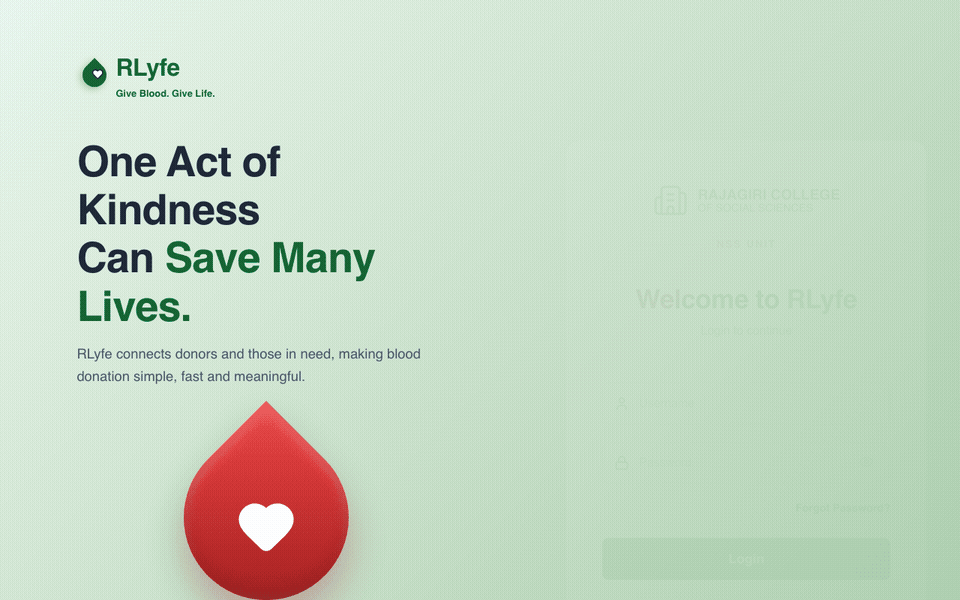
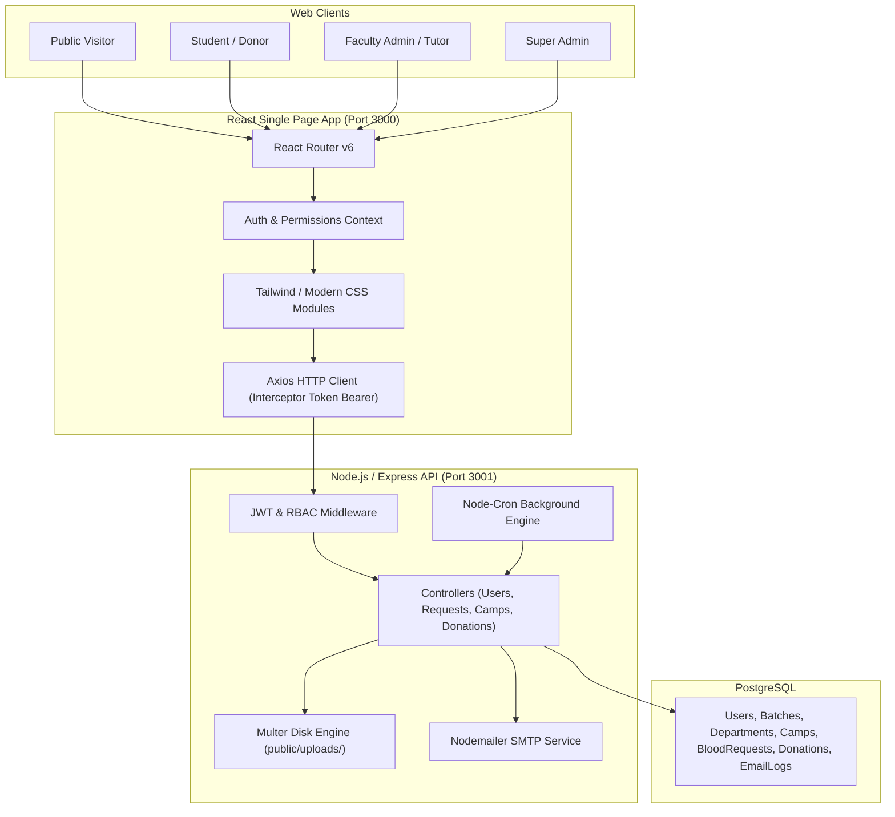

# RLyfe - Rajagiri Blood Donation Platform

<div align="center">
  
  <br />
  <p><strong>Rajagiri Leading Youth for Empowerment — Campus & Community Blood Donation Platform</strong></p>
  <p>
    <a href="#-features">Features</a> •
    <a href="#-architecture--workflow">Architecture</a> •
    <a href="#-role-based-access-control">Role Matrix</a> •
    <a href="#-api-documentation">API Reference</a> •
    <a href="#-getting-started">Installation</a>
  </p>
</div>

---

## 📌 Overview

**RLyfe** is an enterprise-grade blood donation lifecycle management system engineered specifically for colleges, academic institutions, and volunteer communities. Developed under the banner of the **National Service Scheme (NSS) Unit** at **Rajagiri College of Social Sciences**, the platform bridges the critical time gap between urgent blood requirements in local hospitals and eligible student/faculty donors.

The platform streamlines:
- **Emergency blood requests** with immediate broadcast alerts.
- **Institutional donation camp** planning, digital questionnaire eligibility screening, and on-site volunteer attendance.
- **Academic verification pipelines** where class tutors and department heads verify and approve student donation certificates.
- **Medical cooldown tracking** enforcing a mandatory 90-day waiting period between donations with automated reminders.

---

## 🎬 Sneak Peek Preview

The demo preview above showcases the primary workflows:
1. **Welcome & Authentication Portal**: Branded gateway for institutional (@rajagiri.edu) and public users.
2. **Operations Dashboard**: Administrative command center displaying real-time metrics, donor volume, and quick management actions.
3. **Urgent Blood Requests Board**: Live patient needs, hospital locations with Google Maps navigation, urgency status, and volunteer response buttons.
4. **Institutional Blood Camps**: Active and upcoming donation drives with one-click eligibility questionnaire registration.
5. **Donor Profile & Recognition**: Badge rewards (Regular Donor, Gold Donor), verified certificates, and donation timeline.
6. **24/7 Campus Support & Helpline**: Direct contact channels and emergency coordination.

---

## 🚀 Features

### 1. Urgent Blood Requests Management
- **Hospital & Patient Coordination**: Real-time logging of blood requirements specifying units, required date, urgency tier (Normal, High, Critical), hospital address, and Google Maps pin.
- **Bystander Protection**: Collects bystander contact details for direct verification while keeping communications secure.
- **One-Click Volunteer Response**: Logged-in donors can commit to fulfilling a request; the system tracks committed vs. required units in real time.
- **Public & Authenticated Feeds**: Public visitors can review urgent requests, while authenticated donors can register direct commitments.

### 2. Blood Donation Camps & Digital Screening
- **Camp Scheduling**: Administrators publish camp dates, locations, operating hours, and venue maps.
- **Digital Health Questionnaire**: Pre-registration eligibility questionnaire covering:
  - Minimum body weight threshold (>= 45kg)
  - 90-day donation cooldown
  - Recent major surgeries or dental procedures
  - Ongoing medication and chronic illness history
  - Tattoos/piercings within the last 6 months
  - Alcohol consumption within 24 hours
- **On-Site Data Entry**: Volunteers at camp counters record physical donations live, linking student IDs to verified donation records.

### 3. Faculty Verification & Approval Engine
- **Academic Hierarchy Integration**: Reflects institutional academic structures (Departments -> Batches -> Class Tutors -> Students).
- **Certificate Review Pipeline**: When a student uploads a blood donation certificate (PDF or Image), an alert is routed directly to their assigned **Class Tutor**.
- **Audit Trails**: Tutors approve or reject donations with feedback reasons; approved donations immediately credit the student's donor record and unlock donor badges.

### 4. Automated Communications & Notification Engine
- **Urgent Request Broadcasts**: Sends blind-carbon-copy (BCC) alerts to compatible campus donors upon critical request creation.
- **90-Day Eligibility Cron Job**: Automated daily cron scans the donor registry and delivers reminder emails to donors as soon as they become medically eligible to donate again.
- **Monthly Administrative Reports**: Automated statistical digests dispatched on the 1st of every month to Super Admins and HoDs summarizing departmental participation.
- **Tutor Alerts**: Instant notifications to class tutors when their students volunteer or upload proof of external donation.

---

## 🏗️ Architecture & Workflow



---

## 👥 Role-Based Access Control (RBAC)

| Role | Permissions & Capabilities |
| :--- | :--- |
| **Super Admin** | Full root authority: manage system settings, assign administrative privileges, delete users, access analytics, view system audit logs. |
| **Admin** | Operational management: create blood requests, schedule camps, manage departments, manage batches, broadcast emails. |
| **Faculty Admin (HoD / Tutor)** | Departmental overview: view assigned class students, inspect pending donation certificates, approve/reject student donations. |
| **Student / Donor** | Personal dashboard: upload external donation certificates, respond to urgent requests, register for camps, earn donor badges. |
| **Volunteer** | On-site operations: access camp data entry terminal to log attendees and collect physical donations during drives. |
| **Public Guest** | Unauthenticated access: browse urgent blood requests, view upcoming camps, access emergency hospital helpline contacts. |

---

## 🗄️ Database Schema Overview

The database is built on **PostgreSQL** with Sequelize ORM. The relational model consists of:

- **Users**: Core entity storing authentication hashes, institutional email (`@rajagiri.edu`), phone, role enum (`student`, `faculty_admin`, `admin`, `super_admin`, `volunteer`), blood group, physical parameters (height, weight), student ID, and fine-grained administrative permissions.
- **Departments & Batches**: Academic taxonomy mapping departments to HoDs, and academic batches to designated Class Tutors.
- **BloodRequests**: Stores hospital details, patient identifier, blood group, units needed, status (`open`, `fulfilled`, `closed`), coordinates, and Google Maps links.
- **RequestResponses**: Tracks individual donor commitments to specific urgent blood requests with responder contact details.
- **Camps & CampRegistrations**: Organizes physical blood drives and stores participant questionnaire submissions with automated approval/rejection flags.
- **Donations**: Historical log of completed donations with uploaded certificate paths, donor IDs, camp/request associations, and verification state (`pending`, `approved`, `rejected`).
- **EmailLogs & Notifications**: Persistent audit logs for all dispatched transactional emails and in-app bell notifications.

---

## 📡 API Reference

### Authentication (`/api/auth`)
- `POST /api/auth/login` - Authenticate with email and password; returns JWT token and user profile.
- `POST /api/auth/register` - Student self-registration.
- `POST /api/auth/change-password` - First-time login mandatory password reset.
- `POST /api/auth/forgot-password` - Request 15-minute secure password reset link.
- `POST /api/auth/reset-password` - Apply new password using cryptographic token.

### Urgent Blood Requests (`/api/requests`)
- `GET /api/requests` - Fetch list of active blood requests (supports blood group filtering).
- `POST /api/requests` - Create new urgent request *(Admin, Super Admin)*.
- `POST /api/requests/:id/respond` - Submit willingness to donate units for a request.
- `PUT /api/requests/:id` - Update request status or details *(Admin)*.

### Donation Camps (`/api/camps`)
- `GET /api/camps` - List upcoming and completed donation camps.
- `POST /api/camps` - Schedule a new donation drive *(Admin, Volunteer)*.
- `POST /api/camps/:id/register` - Submit medical eligibility questionnaire for a camp.
- `POST /api/camps/:id/data-entry` - Log walk-in donor details at the camp venue.

### Donation Verification (`/api/donations` & `/api/faculty_admin`)
- `POST /api/donations` - Upload donation certificate proof *(Multipart Form / Multer)*.
- `GET /api/faculty_admin/pending-donations` - Retrieve batch student donations awaiting review.
- `PUT /api/faculty_admin/donations/:id/status` - Approve or reject certificate with reason.

---

## 💻 Getting Started

### Prerequisites

- **Node.js**: `v16.x` or higher
- **PostgreSQL**: `v14.x` or higher
- **npm** or **yarn**

---

### Step 1: Clone the Repository

```bash
git clone https://github.com/vkn-can-code/rajagiri-blood-donation.git
cd rajagiri-blood-donation
```

---

### Step 2: Backend Configuration & Setup

1. Enter the backend directory and install dependencies:
   ```bash
   cd Backend
   npm install
   ```

2. Create your `.env` configuration:
   ```bash
   cp .env.example .env
   ```
   Edit `.env` with your local PostgreSQL and email settings:
   ```env
   DB_USER=postgres
   DB_HOST=localhost
   DB_DATABASE=rajagiri_blood_db
   DB_PASSWORD=your_postgres_password
   DB_PORT=5432
   JWT_SECRET=your_super_secret_jwt_key

   EMAIL_USER=your_email@gmail.com
   EMAIL_PASS=your_gmail_app_password

   ADMIN_EMAIL=admin@rlyfe.com
   ADMIN_PASS=Admin@12345
   ADMIN_PHONE=9876543210
   FRONTEND_URL=http://localhost:3000
   ```

3. Initialize the database schema:
   ```bash
   # Create database in postgres
   createdb -U postgres rajagiri_blood_db

   # Load clean schema (DDL, types, sequences, indexes)
   psql -U postgres -d rajagiri_blood_db -f ../schema.sql
   ```

4. Seed the initial Super Admin and demonstration data:
   ```bash
   npm run seed:admin
   npm run seed:data
   ```

5. Launch the backend API server:
   ```bash
   npm start
   ```
   The backend will be running at `http://localhost:3001`.

---

### Step 3: Frontend Configuration & Setup

1. In a new terminal tab, navigate to the frontend directory:
   ```bash
   cd frontend
   npm install
   ```

2. Create the frontend environment file:
   ```bash
   cp .env.example .env
   ```

3. Launch the development server:
   ```bash
   npm start
   ```
   The application will automatically open at `http://localhost:3000`.

---

## ⏰ Automated Background Jobs

The backend includes a continuous cron engine powered by `node-cron`:

| Cron Schedule | Function | Purpose |
| :--- | :--- | :--- |
| `0 0 1 * *` | Monthly Report Engine | Generates monthly statistics and emails summary PDF reports to administrators. |
| `0 9 * * *` | Daily Eligibility Engine | Evaluates donors whose last donation was 90+ days ago and sends eligibility reminders. |
| On Creation | Instant Dispatch Engine | Triggers asynchronous BCC email broadcasts to compatible donors upon urgent blood request creation. |

---

## 🛡️ Security & Privacy Architecture

- **Zero PII in Source Control**: Production user data, real emails, phone numbers, and certificate uploads are strictly excluded via `.gitignore`.
- **Password Protection**: Passwords are salted and hashed using `bcryptjs` with a work factor of 10 rounds; plaintext passwords are never stored.
- **Token Security**: Stateless JWTs carry expiration limits and are verified on protected API routes via Bearer token headers.
- **File Upload Safeguards**: Multer enforces MIME-type restrictions allowing only image (`.jpg`, `.jpeg`, `.png`, `.webp`) and PDF certificate files.

---

## 📜 License

This project is licensed under the **ISC License**. Developed with pride for the **Rajagiri College of Social Sciences NSS Unit**.
